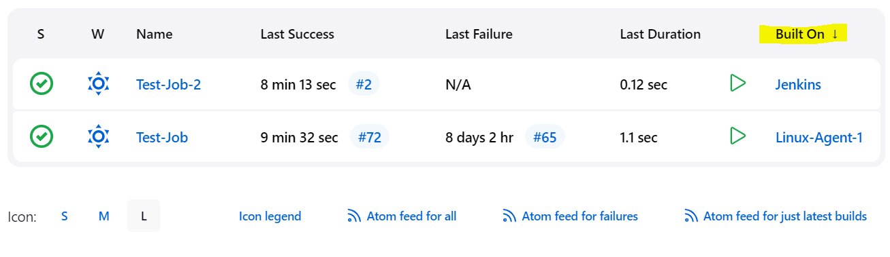

# Built On Column Plugin

Adds a **Built On** column to Jenkins list views that displays the agent (or built-in controller) on which each job's most recent build ran.

## Features

- **Freestyle & `AbstractBuild` jobs**: Displays a link to the agent (or built-in controller) where the last build executed.
- **Pipeline (`WorkflowJob`) jobs**: When the Pipeline plugins (`workflow-api`, `workflow-job`) are installed, walks the `FlowExecution` graph to resolve all execution nodes in chronological order (supporting multi-agent pipelines and controller steps).
- **Deleted / ephemeral agent resilience**: Falls back cleanly to plain text with the recorded node name when an ephemeral cloud agent has since been terminated, instead of rendering a broken link.
- **Unbuilt jobs**: Renders an empty cell cleanly when a job has no prior builds.

## Usage

1. Open or create a **List View** in Jenkins and choose **Edit View**.
2. Under **Columns**, click **Add column** and select **Built On**.
3. Save the view. Each job row now shows a clickable link to the node(s) used by its latest build.

## Contributing & Releases

See [CONTRIBUTING.md](CONTRIBUTING.md) for local build, formatting, and testing instructions, and [GitHub Releases](https://github.com/jenkinsci/built-on-column-plugin/releases) for release notes.
